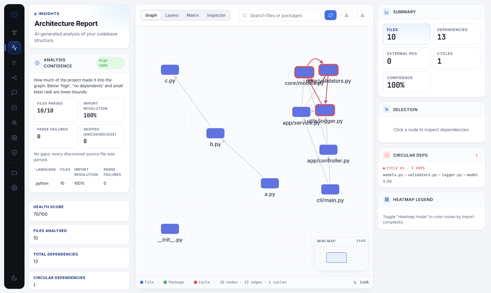
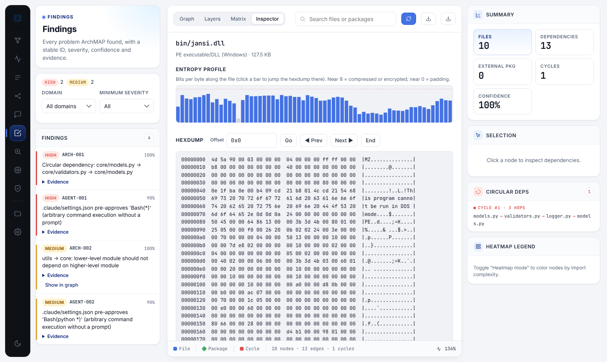
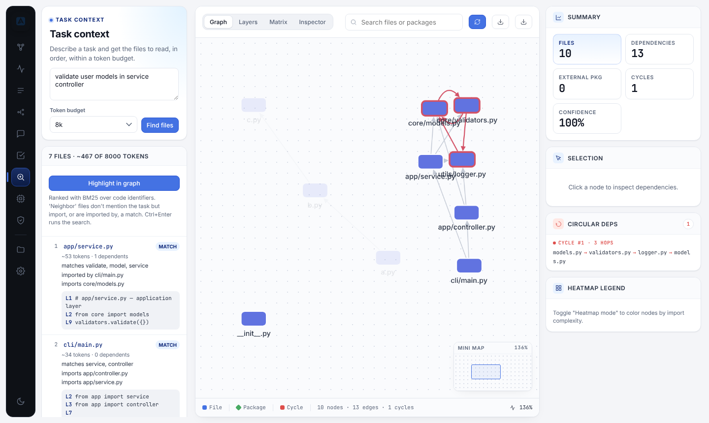
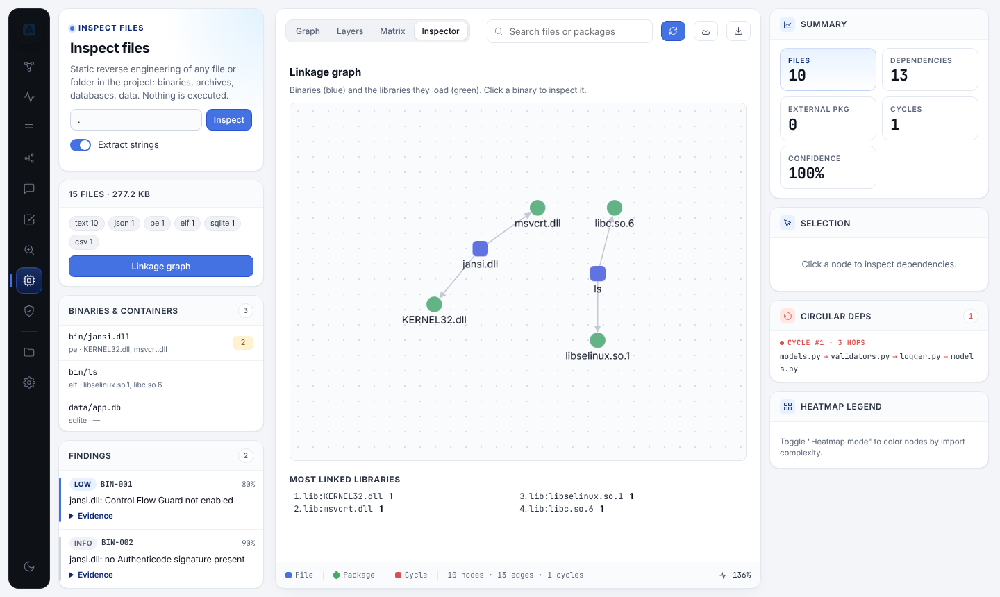
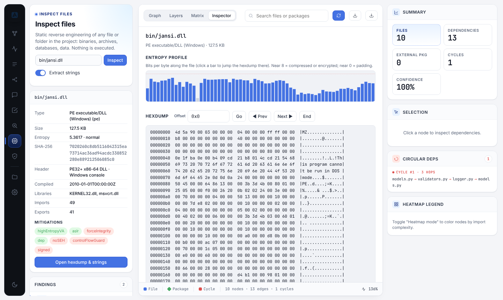
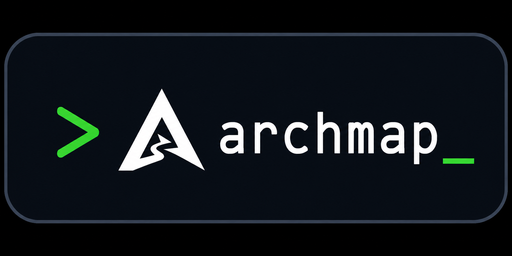

<div class="archmap-hero" markdown>

<p align="center">
  
</p>

<p class="tagline"><em>Map Your Architecture. Control Your Future.</em></p>

<p align="center">
  <a href="https://github.com/Kaua-KGzin/ArchMAP/actions/workflows/ci.yml">
    
  </a>
  
  
  
</p>

[Get started](getting-started/installation.md){ .md-button .md-button--primary }
[CLI reference](cli/analyze.md){ .md-button }
[Web UI tour](#web-ui-tour){ .md-button }

</div>

---

**ArchMAP** maps how a software project is built and tells you what is risky
about it. It reads source code in 9 languages and builds a dependency graph.
From that graph it finds cycles, layer violations, and fragile hotspots, and
it measures how much of the project it actually understood. It also opens
binaries and data files without running them, and audits secrets and
AI-agent configuration.

You can use everything three ways: from the **CLI** (and CI), in an
**interactive web UI**, or through an **MCP server** that gives AI coding
agents the same answers.

```bash
pip install KG-ARCHMAP
archmap analyze .          # report + quality gates
archmap serve .            # interactive web UI on http://127.0.0.1:3000
archmap mcp .              # MCP server for Claude Code, Cursor, Windsurf
```

!!! info "Design principles"
    **Zero runtime dependencies** (Python standard library only), so it runs
    on Linux, macOS, Windows, and Android/Termux. **Offline and
    deterministic**: the same input gives the same answer, with evidence.
    **Never executes what it analyzes**: code, binaries, and archives are
    only read.

## What ArchMAP does

<div class="grid cards" markdown>

-   :material-graph-outline:{ .lg .middle } __1. Maps code architecture__

    ---

    Parses Python, JavaScript, TypeScript, Rust, Go, PHP, Java, C#, and
    C/C++ into a file-level dependency graph, using tree-sitter when it's
    installed and a regex fallback per file otherwise. On top of the graph:

    - circular dependencies, with a suggested edge to break;
    - god modules, dependency explosions, and layer violations;
    - custom `forbid`/`allow` rules from `.archmap.toml`;
    - a 0–100 health score and a risk score and blast radius per file.

    [:octicons-arrow-right-24: `analyze`](cli/analyze.md) ·
    [`risk`](cli/risk.md) · [`trace`](cli/trace.md) · [`diff`](cli/diff.md) ·
    [`temporal`](cli/temporal.md)

-   :material-gauge:{ .lg .middle } __2. Measures how far to trust it__

    ---

    Every report says how much of the project made it into the graph:

    - files discovered vs. parsed;
    - parse failures, with the error;
    - files skipped for encoding or size;
    - import resolution per language.

    These combine into a confidence level (high/medium/low). When it isn't
    high, "no dependents" is only a lower bound.

    [:octicons-arrow-right-24: Analysis quality](cli/analyze.md#analysis-quality-metricsanalysisquality)

-   :material-shield-check:{ .lg .middle } __3. Guards quality in CI__

    ---

    Fail a build (exit code `2`) on any of:

    - cycles, layer or rule violations, god modules;
    - coupling budgets or a minimum health score;
    - import resolution or parse coverage below a threshold;
    - binary mitigations or audit findings at a chosen severity.

    SARIF export feeds GitHub Code Scanning; a reusable GitHub Action and a
    pre-commit hook are included.

    [:octicons-arrow-right-24: CI quality gates](cli/analyze.md#ci-quality-gates)

-   :material-robot-outline:{ .lg .middle } __4. Gives AI agents the right context__

    ---

    - A 15-tool **MCP server** answers what an agent would otherwise learn
      one file read at a time.
    - **Task context** returns the files to read for a task, ranked, within
      a token budget.
    - **`archmap memory`** gives the agent a digest at session start.
    - A **Claude Code plugin** and portable **skill** teach the agent when to
      call each tool.

    [:octicons-arrow-right-24: MCP](cli/mcp.md) · [`context`](cli/context.md) ·
    [`memory`](cli/memory.md) · [Plugin](agents.md)

-   :material-chip:{ .lg .middle } __5. Static reverse engineering__

    ---

    Identifies 30+ formats by magic bytes and reads them without running
    anything:

    - **ELF, PE, Mach-O, WebAssembly**: linked libraries, imports/exports,
      mitigations (NX, PIE, RELRO, ASLR, DEP, CFG, …), packers, toolchain;
    - **Data and containers**: JSON, CSV, SQLite, APK/JAR/ZIP, tar.

    Plus entropy, classified strings, a hexdump, and a binary→library graph
    for whole folders (firmware, `dist/`, APK `lib/`).

    [:octicons-arrow-right-24: `inspect`, `hexdump`, `strings`](cli/inspect.md)

-   :material-lock-check:{ .lg .middle } __6. Security__

    ---

    - **Secrets**: git-aware detection; values always redacted.
    - **AI-agent configuration as attack surface**: unpinned or plaintext
      MCP servers, `bypassPermissions`, hooks that pipe downloads into a
      shell, invisible Unicode in `CLAUDE.md`/`AGENTS.md`.
    - **Network exposure**: open ports correlated with the code that uses
      them.

    [:octicons-arrow-right-24: `audit`](cli/audit.md) ·
    [`netscan`](cli/netscan.md) · [`expose`](cli/expose.md)

</div>

## One findings model

Every problem ArchMAP reports, from any analyzer, has the same shape: a
stable `id`, a `severity` (`info` → `critical`), a `confidence` (0–1), a
message, and `evidence`. The ID prefix tells you where it came from:

| Prefix | Domain | Produced by | Examples |
|---|---|---|---|
| `ARCH-*` | code | `analyze` | circular dependency, god module, layer/rule violation |
| `QUAL-*` | quality | `analyze` | parse failure, undecodable file, low import resolution |
| `NET-*` | network | `expose` | open port mapped to a library the code imports, rule drift |
| `BIN-*` | binary | `inspect` | executable stack, no PIE/ASLR/DEP, packed, zip-slip archive |
| `SEC-*` | security | `audit` | committed AWS/GitHub/private key (redacted) |
| `AGENT-*` | agent | `audit` | `Bash(*)` pre-approved, unpinned MCP package, risky hook |

Quote the ID when discussing a finding; the evidence explains why it fired.

## Web UI tour

`archmap serve .` opens an interactive UI in 6 languages (English,
Português, Español, Français, Deutsch, 中文) that works on desktop and phones.

| View | What you can do |
|---|---|
| **Graph** | Explore the dependency graph; filter by folder, cycles, or complexity heatmap; click a node for imports, dependents, and blast radius |
| **Insights** | Health metrics and the **analysis-confidence** card (parse coverage, failures, resolution per language) |
| **Rules & Layers** | Layer hierarchy, violations, and `.archmap.toml` rules |
| **Trace** | Everything an entrypoint transitively pulls in, and what is unreachable |
| **AI Advisor** | Ask an LLM (Claude, OpenAI, Ollama, any OpenAI-compatible API) for refactoring advice |
| **Findings** | Every finding (`ARCH`, `QUAL`, and after an audit `SEC`/`AGENT`) filtered by domain and severity; *Show in graph* jumps to the file |
| **Task context** | Describe a task; get the files to read in order with matching lines, and highlight them in the graph |
| **Inspect files** | Inspect any file or folder in the project; the **Inspector** tab shows the entropy profile, a paged hexdump, filterable strings, and the binary→library graph |
| **Security audit** | Run the secrets and AI-agent configuration audit |
| **Layers / Matrix** | Layer diagram and dependency matrix of the most connected files |

=== "Analysis confidence"

    

=== "Findings"

    

=== "Task context"

    

=== "Inspect a folder"

    

=== "Inspector"

    

The server binds to `127.0.0.1` by default; endpoints that read files or
change state only answer loopback requests that send JSON. See
[`serve`](cli/serve.md#security).

## Which surface has what

| Capability | CLI | Web UI | MCP tool |
|---|---|---|---|
| Dependency graph, health, risks | `analyze`, `explain`, `risk` | Graph, Insights | `get_architecture_summary`, `get_file_context`, `impact_analysis` |
| Analysis quality | `analyze` (summary + JSON) | Insights | `get_analysis_quality` |
| Unified findings | `analyze --format json` | Findings | `list_findings` |
| Quality gates | `analyze --fail-on-*`, `--min-*` | — | `run_checks` |
| Reachability / dead code | `trace` | Trace | `trace_reachability` |
| Architecture diff | `diff` | — | `diff_architecture` |
| Task context | `context` | Task context | `get_relevant_context` |
| Agent memory digest | `memory` | — | `get_project_memory` |
| Reverse engineering | `inspect`, `hexdump`, `strings` | Inspect files + Inspector | `inspect_path`, `hexdump`, `extract_strings` |
| Secrets & agent config | `audit` | Security audit | `audit_project` |
| Network exposure | `netscan`, `expose` | — | `get_network_exposure` |
| LLM advice | `advise` | AI Advisor | — |

## Getting started

<p align="center">
  
</p>

1. [Installation](getting-started/installation.md): PyPI, Docker, the optional tree-sitter extra, Termux
2. [Quick Start](getting-started/quickstart.md): analyze and serve your first project
3. [AI agent plugin](agents.md): one command to give Claude Code, Cursor, or Codex the ArchMAP tools
4. [Live Demo](getting-started/demo.md)

## CLI reference

| Command | Purpose |
|---|---|
| [`analyze`](cli/analyze.md) | Full report, analysis quality, quality gates, Mermaid/JSON/Cytoscape/SARIF |
| [`explain`](cli/explain.md) | Human-readable architecture summary |
| [`risk`](cli/risk.md) | Blast radius and risk score for a file |
| [`improve`](cli/improve.md) | Structural suggestions + refactor script |
| [`serve`](cli/serve.md) | Interactive web UI (graph, insights, findings, context, inspect, audit, …) |
| [`diff`](cli/diff.md) | Compare git refs or JSON snapshots |
| [`trace`](cli/trace.md) | BFS reachability from any entrypoint |
| [`init`](cli/init.md) | Generate `.archmap.toml` from a real dependency graph |
| [`advise`](cli/advise.md) | LLM-powered architectural advisor |
| [`temporal`](cli/temporal.md) | Temporal coupling via git history |
| [`context`](cli/context.md) | Files to read for a task, packed into a token budget |
| [`inspect`](cli/inspect.md) | Static reverse engineering of files and folders |
| [`hexdump`](cli/inspect.md#archmap-hexdump) | Hex + ASCII dump of a byte range |
| [`strings`](cli/inspect.md#archmap-strings) | ASCII/UTF-16 strings, optionally only the interesting ones |
| [`audit`](cli/audit.md) | Secrets, cross-file data flow (taint), insecure code patterns, and risky AI-agent configuration |
| [`mcp`](cli/mcp.md) | MCP server for AI assistants (15 tools) |
| [`memory`](cli/memory.md) | Persistent architecture digest for AI coding agents |
| [`commands`](cli/context.md#archmap-commands) | Machine-readable catalog of every command and option |
| [`watch`](cli/watch.md) | Continuous analysis on file change |
| [`netscan`](cli/netscan.md) | Network host discovery + port scanning, nmap-style |
| [`expose`](cli/expose.md) | Correlate open network ports/services with the dependency graph |

## What's new

- **1.4.1**: security and accuracy review from a field test on real
  repositories — interprocedural taint analysis (`TAINT-*`) across files for
  Python, JS/TS, C# and Java; CWE-tagged insecure-code checks (`CODE-*`);
  SARIF export for `audit`; context-aware secret ranking; precise C# `using`
  resolution (no more namespace cliques); NestJS/Angular dotted imports
  (`x.service`) resolved; vendored code excluded from risk ranking;
  `--no-cache` fixed.
- **1.4.0**: static reverse engineering (`inspect`, `hexdump`, `strings`),
  analysis-quality metrics with `QUAL-*` findings and CI gates, `audit` for
  secrets and AI-agent configuration, `context` for task-scoped file
  ranking, seven new MCP tools, a Claude Code plugin, and five new web UI
  views (Findings, Task context, Inspect + Inspector, Security audit,
  analysis confidence).
- **1.3.0**: unified findings model (`ARCH-*`, `NET-*`) with stable IDs,
  severity, confidence, and evidence.
- **1.2.0**: `archmap memory`, a persistent markdown digest of the project's
  architecture for AI coding agents to read at session start.
- **1.1.x**: `archmap netscan` and `archmap expose`, nmap-style network
  discovery correlated with the dependency graph, with confidence scoring and
  `[network.rules]` drift detection.

See the full [Changelog](changelog.md) and [Roadmap](roadmap.md).

## Governance and release

- [Branching Strategy](BRANCHING.md)
- [Contributing Guide](contributing.md)
- [Code of Conduct](code-of-conduct.md)

## Attribution

Original distributor: **Kaua Gabriel / Kauã Gabriel** (Kaua-KGzin).
See [Original Distribution Notice](notice.md) and the [MIT License](https://github.com/Kaua-KGzin/ArchMAP/blob/main/LICENSE).
